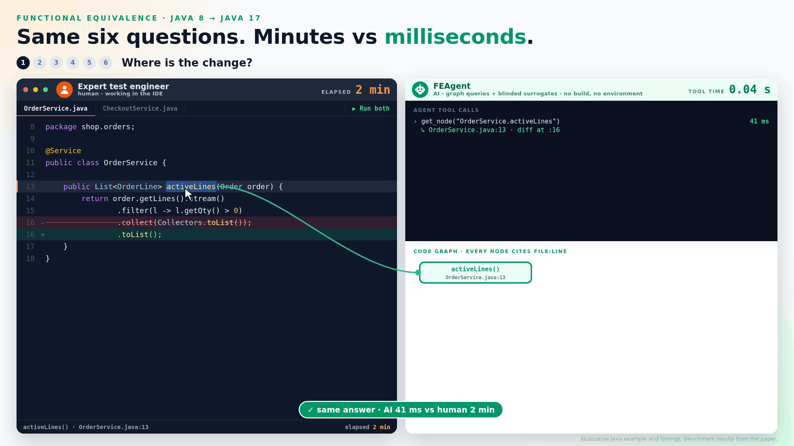
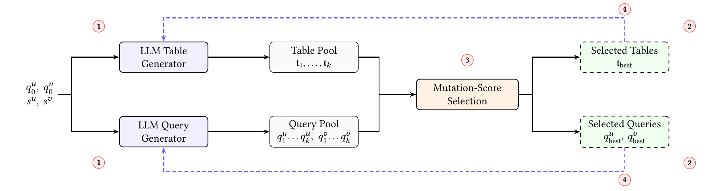

As LLMs increasingly translate, migrate, and patch code, the key question is: *does the new code still behave like the old code?* Passing tests is not enough. Subtle semantic differences can silently change results. This research develops methods to detect behavioral divergence and to measure how much confidence a "no difference found" verdict deserves.

## Graph-Grounded Functional Equivalence

This work simulates how an expert test engineer reviews a code change (trace callers and callees, pick inputs that reach risky paths, compare old and new behavior), without building or running the code.

- **Grounded reasoning:** bounded code-graph queries, where every answer cites a source line.
- **Differential surrogates:** two blinded LLMs each predict one version's behavior, and a deterministic reconciler gives the final verdict: *EQUIVALENT*, *INEQUIVALENT*, or *UNCLEAR*.
- **Language-agnostic:** works on hard-to-execute code such as legacy .NET Framework or COBOL.
- **Findings** (all confirmed by executing counterexamples): 28.4% of test-passing agent patches on SWE-bench Verified behave differently from the reference fix, and 18% of EquiBench labels are contradicted.

[Read the paper here](https://arxiv.org/abs/2610.04371)

Illustrative demo: an expert test engineer and the agent answering the same six questions about a code change

## Mutation-Score-Guided Testing for Database Migration

SQL dialects differ in subtle ways, such as case sensitivity, integer division, and NULL handling, so a syntactically valid translation can still return different results.

- **Adversarial LLM loop:** one LLM generates test data aimed at exposing differences, while another generates query mutants that try to evade the current tests.
- **Confidence, not just pass/fail:** the resulting mutation score is calibrated into an estimate of the risk that a non-equivalent pair goes undetected.
- **Result:** on 1,035 cross-dialect migration pairs, query-aware test generation cut the false negative rate from 58.3% to 20.0%.

[Read the paper here](https://dl.acm.org/doi/epdf/10.1145/3843750.3843845)

Iterative test data and mutant generation guided by mutation scores

